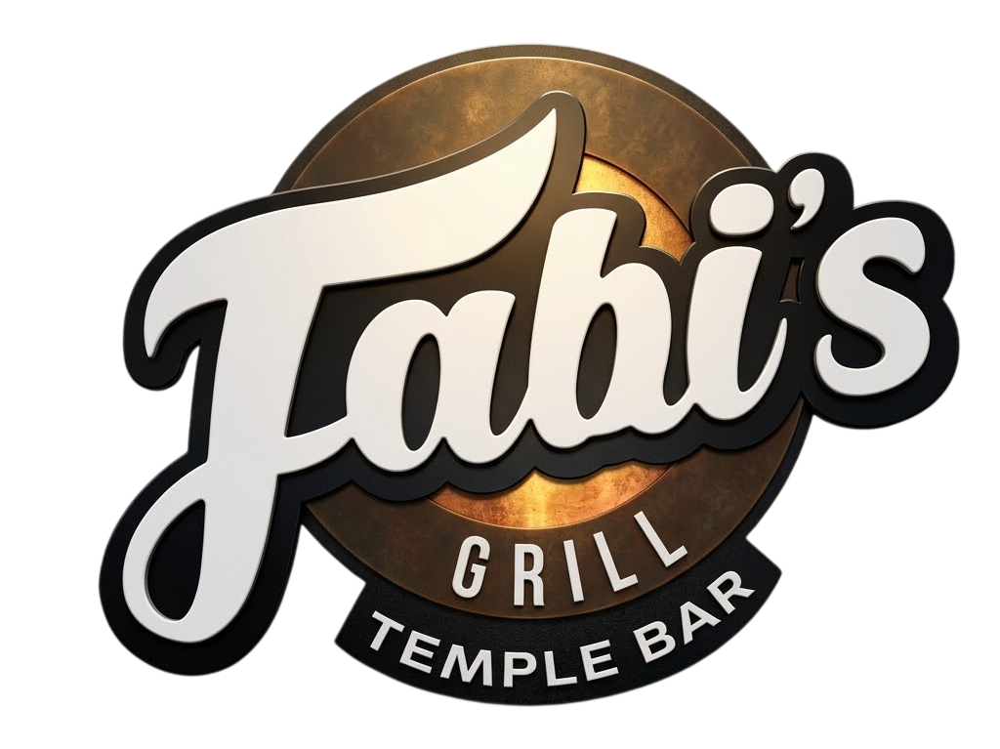

# 🍽️ Fabi's Grill — Order System

> Sistema de pedidos em tempo real para o restaurante **Fabi's Grill Temple Bar** (Dublin, Irlanda).
> Feito para simplificar o dia a dia da equipe: todos marcam itens num app, e no fim do dia alguém envia o pedido ao fornecedor certo via WhatsApp.

---

## 📋 Índice

- [Sobre o projeto](#-sobre-o-projeto)
- [Funcionalidades](#-funcionalidades)
- [Como funciona](#-como-funciona)
- [Tecnologias](#-tecnologias)
- [Estrutura de ficheiros](#-estrutura-de-ficheiros)
- [Como usar](#-como-usar)
- [Fornecedores](#-fornecedores)
- [Auto-limpeza diária](#-auto-limpeza-diária)
- [Como publicar (GitHub Pages)](#-como-publicar-github-pages)
- [Configuração Firebase](#-configuração-firebase)
- [Desenvolvimento](#-desenvolvimento)
- [Autor](#-autor)
- [Licença](#-licença)

---

## 🎯 Sobre o projeto

O **Fabi's Grill Order System** é um web app leve (roda no navegador, sem instalação) criado para resolver um problema simples:

> **"Como é que a equipe toda marca o que precisa de ser pedido, sem andar a mandar mensagens soltas no WhatsApp?"**

A solução:
- Todos abrem o mesmo link no telemóvel
- Marcam os itens que precisam com a quantidade
- Tudo sincroniza em **tempo real** entre todos os dispositivos
- No fim do dia, uma pessoa abre o app, vê tudo o que foi marcado e envia para o fornecedor certo

O app é **leve**, **funciona offline** parcialmente, **não precisa de login** e pode ser **adicionado ao ecrã principal** do telemóvel como se fosse uma app nativa.

---

## ✨ Funcionalidades

### 🛒 Lista de itens organizada
- **54 itens** organizados por 7 categorias:
  - 🥬 Vegetables/Fruits
  - 🥩 Meat
  - 🧂 Grocery
  - 🍞 Bread/Rice
  - 🥤 Drinks
  - 🧴 Cleaning
  - 📦 Packaging
- Cada item mostra o **nome em inglês** + **tradução em português** (para novos staffs)
- **Badge visual** (BOX / BAG / PACK / TRAY) para identificar o tipo de embalagem

### 🔄 Sincronização em tempo real
- Baseada em **Firebase Realtime Database**
- Quando um staff marca um item, todos os outros veem a alteração em **~1 segundo**
- Indicador visual no canto superior direito: **"Synced"**, **"Saving..."** ou **"Error"**

### 📱 Multi-fornecedor
- Botões individuais para enviar o pedido a cada fornecedor:
  - **Ercan** (default)
  - **Sysco**
  - **Musgrave**
  - **Freshpoint**
- Cada botão abre o WhatsApp com a **mensagem personalizada** para aquele fornecedor
- Exemplo: clicar em **Sysco** → mensagem começa com `Hello Sysco, could you send it to Fabis Grill temple bar, ...`

### 🎨 Design Fabi's Grill
- Paleta de cores retirada da logo oficial:
  - **Marrom queimado** (`#8b5a2b`)
  - **Dourado** (`#c8873a`)
  - **Creme** (`#f5f0e6`)
  - **Preto carvão** (`#1a1a1a`)
- Item fica **verde** quando marcado
- Efeitos suaves, transições fluidas

### 🌍 Multi-idioma
- Interface em **inglês** ou **português**
- **Os itens NUNCA mudam** (ficam sempre em inglês + tradução em baixo)

### 🤖 Auto-limpeza diária
- Todos os dias às **6h da manhã**, o pedido é **limpo automaticamente**
- Só o primeiro dispositivo que abrir depois das 6h executa a limpeza
- Como é sincronizado, **todos os staffs veem vazio ao mesmo tempo**

### 🎯 Extras
- **Zoom bloqueado** — tela estática para não ampliar sem querer
- **Menu lateral** deslizante com swipe gesture
- **Modais bonitos** para confirmar ações (Clear all)
- **Pop-up About** com info do desenvolvedor
- **Pode ser adicionado ao ecrã principal** (PWA-style)

---

## ⚙️ Como funciona
